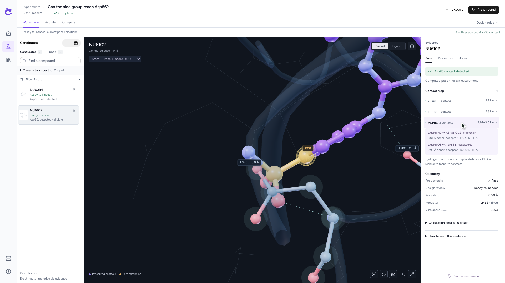

# CapyChem

**A local 3D workspace for structure-guided molecular design.** Bring two related molecules or generate variants from a shared core. See how a small change affects their calculated fit inside a protein pocket, inspect the atoms that come into contact, and export the exact pose on screen. The first workflow explores the CDK2 pocket.

[Watch the 28-second product tour](assets/demo/v10/capychem-studio-launch.mp4?raw=1) · [Try the recorded workspace](#try-the-workspace) · [Run a live experiment](#quick-start) · [How it works](#under-the-surface)

[](assets/demo/v10/capychem-studio-launch.mp4?raw=1)

In the tour, two supplied molecules produce six possible poses in a 23-second local calculation. Switch molecules, inspect a contact, and download the coordinates behind it. [Get the inspected pose (SDF)](docs/redesign/reliability-v8/film-selected-pose.sdf?raw=1)

## Try the workspace

The portable demo includes 11 recorded experiments and three studies. You need Python 3 and a browser with WebGL. You can inspect the original coordinates, compare runs, and download poses offline after the initial download. Shared exports include the scientific files and their checksums. Machine-specific worker logs stay local.

1. [Download the demo ZIP](assets/demo/capychem-studio-demo.zip?raw=1) and extract it.
2. In the folder containing `serve.py`, run `python3 serve.py`.
3. [Open the CDK2 experiment](http://127.0.0.1:5182/experiments/58c63b90-086a-4cb6-adee-e09657734574?mode=demo). Switch from **NU6094** to **NU6102**, select **ASP86** in the contact map, and rotate the pocket. **Download selected pose** saves the coordinates on screen.

## What can you learn from a run?

In this example, the molecules share a core and differ at one end. Can that end reach **Asp86**, a particular amino acid in CDK2, while the core keeps its contacts in the pocket? A **pose** is one calculated position and shape of a molecule. Moving the added group by a few ångströms can change which atoms it reaches.

The recorded study repeats the same calculation with three different random seeds. All nine selected poses passed the review checks.

| Molecule | What changed | Runs with an Asp86 contact in the selected pose |
| --- | --- | ---: |
| NU6094 | Starting molecule | 0 of 3 |
| NU6102 | Added a sulfonamide group | 3 of 3 |
| Para carboxamide | Added a carboxamide group | 2 of 3 |

With the demo running, [open the three-run study](http://127.0.0.1:5182/studies/a73fc517-6425-490a-a921-9ea3e7c0686d?mode=demo) and select the carboxamide run that missed. Compare its pose with one that reached Asp86. Each cell opens the coordinates behind its result.

The selection rule favors a plausible pose that makes the target contact. The counts tell you how often the calculation found one under that rule. The protein is held fixed in a structure selected from a known NU6102 complex. Predicting binding strength or activity would require separate validation. [Watch the CDK2 case study](assets/demo/v8/capychem-launch-silent.mp4?raw=1) · [Scientific evidence and scope](docs/redesign/validation-overview.md)

## Quick start

To calculate fresh poses, run the Studio, API, and worker locally. The live setup has been tested on **macOS with Apple silicon**, using **uv**, **Node.js 22+**, **pnpm 11.5**, and **PostgreSQL 16+**. The supplied-molecule workflow runs on CPU without model weights or API credentials.

Run these commands from the repository root.

```bash
uv sync --frozen --python 3.12
pnpm install --frozen-lockfile
uv python install 3.11
.venv/bin/python scripts/setup_science.py --python "$(uv python find 3.11)"
.venv/bin/python scripts/dev.py
```

Open [the local Studio](http://127.0.0.1:5181), choose **New experiment → Evaluate candidates**, and follow the [walkthrough with three paste-ready molecules](docs/launch-v5/first-run.md). To enable **Generate variants**, add `--with-generator` to the science setup command before starting the launcher. That installs CPU PyTorch and downloads the pinned LibInvent checkpoint (about 90 MB).

The launcher starts a dedicated local Postgres cluster and saves experiment files under `.local/artifacts`. For an existing database, platform-specific Vina setup, or frontend-only development, see the [contributor guide](CONTRIBUTING.md).

## Where the model fits

| Step | What runs |
| --- | --- |
| Choose molecules | Supply your own related molecules, or use **REINVENT4’s pretrained LibInvent model** to propose side groups for the shared core. Its input is the scaffold. The protein and contact objective enter during screening. |
| Calculate poses | **RDKit** checks structures and builds starting shapes. **Meeko** prepares inputs for **AutoDock Vina**, which refines each placement near the aligned parent molecule. |
| Inspect the evidence | **PoseBusters** checks geometry. **ProLIF** identifies contacts. The Studio shows the atoms and distances behind a result and lets you compare alternative poses. |

In one live generator run, LibInvent proposed 12 variants. After removing duplicates and applying property limits, three went through pose evaluation. None reached the target under the review rules. Those poses are still available for inspection. The Studio runs inference with existing weights and evaluates candidates locally. The original LLM optimizer and its Graph-GA comparison have their own [benchmark guide and results](README-benchmarks.md). [Live generation record](docs/redesign/reliability-v8/system-validation.json)

## Under the surface

The React and Three.js workspace submits a versioned experiment to FastAPI. Postgres stores the inputs, seeds, job state, and review decisions. A separate Python worker claims the job and calls the scientific tools. Closing the tab leaves the calculation running. If a worker dies, another attempt can replay the saved specification.

Each pose has its own identity and coordinate file. The API verifies the file hash on download, so a selected pose can be traced from the 3D view back to a particular calculation. [Studio](apps/studio) · [API](apps/api) · [Experiment engine](packages/core/capychem/experiments) · [Restart checks](docs/redesign/reliability-v8/restart-verification.json)

## Credits and license

CapyChem code is available under the [MIT license](LICENSE). The workspace builds on [REINVENT4](https://github.com/MolecularAI/REINVENT4), [RDKit](https://www.rdkit.org/), [Meeko](https://github.com/forlilab/Meeko), [AutoDock Vina](https://github.com/ccsb-scripps/AutoDock-Vina), [PoseBusters](https://github.com/maabuu/posebusters), and [ProLIF](https://github.com/chemosim-lab/ProLIF). Protein structures come from PDB entries [1H1Q](https://www.rcsb.org/structure/1H1Q) and [1H1S](https://www.rcsb.org/structure/1H1S). Third-party tools, model weights, and bundled assets carry their own terms. [Studio notices](apps/studio/public/THIRD_PARTY_NOTICES.txt) · [Scientific data notices](data/reference/cdk2/THIRD_PARTY_NOTICES.txt)
