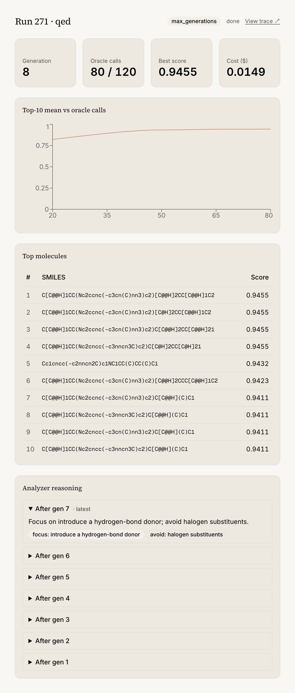
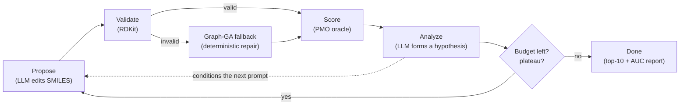
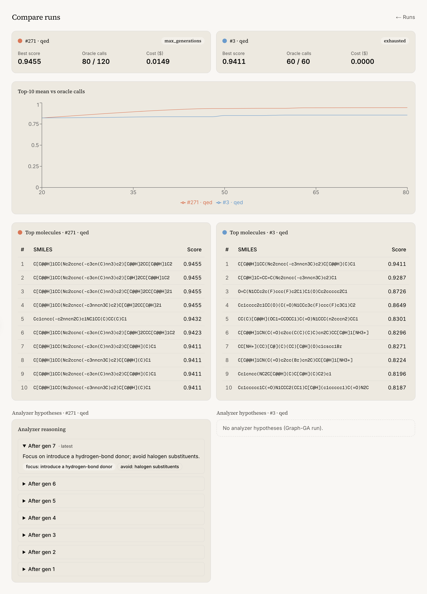
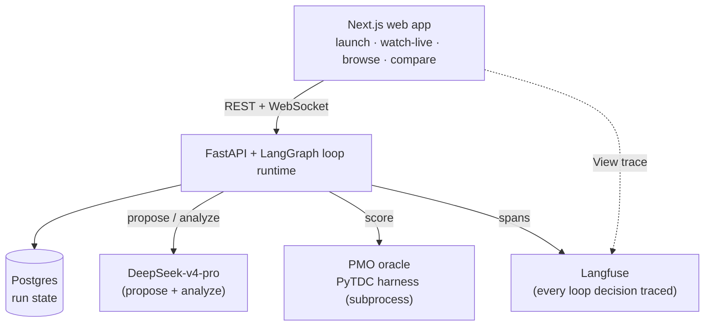

# CapyChem

[](https://github.com/ogngnaoh/capychem/actions/workflows/ci.yml)

**A closed-loop agent for sample-efficient black-box optimization over chemical space.**

CapyChem searches for high-scoring molecules against a fixed, expensive scoring budget by running a
tight **design → score → analyze → redesign** loop: a language model proposes candidate molecules, each
is scored by a benchmark oracle, and — the part most systems skip — the model then *reasons over what
just worked* and conditions its next round of proposals on that hypothesis. The goal is not the best
molecule per hour of compute; it's the **best molecule per oracle call**.

> **In-silico only.** Every score in this project is a standardized in-silico benchmark-oracle score. CapyChem
> optimizes those scores and reports them as such. It makes **no claim of real-world drug-discovery efficacy**,
> and it is strictly upstream of any patient, wet-lab, or clinical use.

<p align="center">
  
</p>

*A finished run: the top-10 mean score climbs with each batch of oracle calls, the best molecules are listed
with their scores, and every generation records the hypothesis the agent used to steer the next one.*

---

## What it is (no chemistry required)

You give CapyChem an **objective** (a scoring function — e.g. "how drug-like is this molecule?") and a
**budget** (how many times you're allowed to call that scoring function). Calling the oracle is the expensive,
rationed resource, so the whole game is spending those calls wisely.

Each generation, the agent:

1. **Proposes** a batch of candidate molecules (as text strings — SMILES) by asking an LLM to edit the current
   best ones.
2. **Validates** every candidate with a chemistry toolkit (RDKit); anything malformed is repaired by a
   deterministic fallback so a bad LLM batch never wastes the budget or stalls the loop.
3. **Scores** the valid candidates against the benchmark oracle.
4. **Analyzes** the results — the LLM looks at what scored well vs. poorly and writes a short hypothesis
   (*"focus: introduce a hydrogen-bond donor; avoid: halogen substituents"*).
5. **Redesigns**: the next generation's prompt is conditioned on that hypothesis. Repeat until the budget is
   spent or the score plateaus.

The **analyze step (4) is the differentiator.** The reference architecture this project reimplements
(MOLLEO) uses an LLM only as a mutation operator — it has *no* analyze step. Adding a closed analysis loop is
what makes CapyChem an *agent that reasons about its own progress* rather than a fancy random-mutation engine.

## Results — the benchmark (G1)

CapyChem was measured on **PMO** (Practical Molecular Optimization), the standard 23-task benchmark the field
uses to compare sample-efficient optimizers. The metric is **AUC of the top-10 mean score vs. oracle calls**
under a **10,000-oracle-call budget** — it rewards getting good *early*, not just eventually. The baseline is
**vanilla Graph-GA**, a strong classical genetic algorithm (not a trivial one).

**With its analyzer loop, CapyChem beat or matched vanilla Graph-GA on all 21 reproducible PMO tasks
(single seed, 10k-call budget) — by a decisive margin (~0.1 AUC or more) on 9 of them.** The bar for this
project's benchmark goal was ≥ 6 of 23; it cleared that at 21.

Honest reading of that number:

- **Denominator is 23.** **2 tasks are excluded for cause** — not because CapyChem lost, but because their
  oracle is defective in the pinned legacy benchmark environment:
  - `sitagliptin_mpo` — the oracle emits scores outside `[0, 1]`, which the metric can't compare.
  - `valsartan_smarts` — the Graph-GA control scores **0.757** where the published PMO value is **0.000**; the
    pinned oracle rewards a molecule pocket the canonical task doesn't, so the task isn't faithfully reproduced
    here. (These were caught by a baseline-reproduction check, and excluded, not silently kept.)
- **Single seed.** One seed per task, not an averaged multi-seed study.
- **Thin margins on 4 tasks** (within single-seed noise, `< 0.03` AUC): `qed` (+0.005), `deco_hop` (+0.009),
  `zaleplon_mpo` (+0.018), `drd2` (+0.024). We report them as ties, not wins.
- **No SOTA claim.** State-of-the-art on PMO is a non-LLM method (Genetic GFN). The value here is the
  **closed analysis loop, flexibility, and explainability** under a hard oracle budget — not topping a
  leaderboard.

| | |
|---|---|
| Beat-or-matched (comparable tasks) | **21 / 21** |
| Decisive wins (~0.1 AUC or more) | **9** |
| Ties (< 0.03 AUC) | 4 |
| Excluded for cause (oracle defects) | 2 of 23 |
| Benchmark goal (bar) | ≥ 6 of 23 → **met** |
| Full-sweep compute cost | **$18.94** (10k calls × ~21 tasks, under the $20 cap) |

Decisive wins included `troglitazone` (+0.563), `mestranol` (+0.397), and `celecoxib` (+0.344). The full
per-task verdict — every AUC, the baseline-reproduction gap, and the exclusion rationale — is committed at
[`docs/04-compare-and-polish/g1-full23-10k-seed42.json`](docs/04-compare-and-polish/g1-full23-10k-seed42.json).

## How the closed loop works



The dashed arrow is the loop that MOLLEO lacks: the analyzer's hypothesis flows forward into the next
proposal prompt. Below, the analyzer's actual per-generation reasoning from a real run — legible without any
chemistry background:

<p align="center">
  
</p>

Every one of these steps is traced. From any run you can click **View trace** to open the full decision tree
in Langfuse — see the [trace walkthrough](docs/langfuse-walkthrough.md) for a step-by-step read of one run.

## The operator surface

A single Next.js web app covers the four operator flows end to end, talking to the FastAPI backend over REST
and a live WebSocket. (The UI adopts a warm, claude.ai-leaning design system.)

| Launch a run | Browse all runs |
|---|---|
|  |  |

**Compare two runs** overlays their score curves and puts their molecules and hypotheses side by side. Here an
LLM+analyzer run (coral) is compared against a vanilla Graph-GA run (blue) on the same task — note the
Graph-GA side reads *"No analyzer hypotheses (Graph-GA run)"*, which is exactly the capability gap CapyChem
closes:

<p align="center">
  
</p>

## Architecture



A few decisions worth calling out:

- **The oracle bridge is a hard isolation boundary.** The PMO benchmark pins a legacy stack (PyTDC 0.3.6,
  Python 3.10). That lives in a separate `harness/` environment; modern code never imports it — it shells out
  via a typed JSON subprocess. This keeps the reproducible-benchmark contract intact without dragging old
  dependencies into the app.
- **Backend posture: built for expensive oracles, demonstrated on cheap ones.** The scored resource is
  *oracle calls*, so the backend treats them as first-class: a **unique-call budget** (memoized scoring so a
  re-proposed molecule never burns a second call), a **per-run cost ledger** (LLM + oracle summed, with a hard
  cost gate), and async batched scoring. The PMO oracles here are CPU-cheap; the same layer is what would carry
  an expensive docking oracle.
- **Observability is the source of truth.** Every LangGraph node (`propose`, `validate`, `score`, `analyze`,
  `fallback`, `stop_check`) emits a Langfuse span nested under a per-run trace, so "what did the agent decide,
  and why?" is auditable step by step.

## Quickstart

Prerequisites: Python 3.12 + [`uv`](https://docs.astral.sh/uv/), Node 22 + `pnpm` 11.5.0, Docker. The harness's
Python 3.10 (PyTDC 0.3.6) is fetched automatically by `uv` — you don't install it.

```bash
git clone <repo> && cd CapyChem
make setup     # deps (modern + harness) · .env.local · local Postgres
make dev       # API on :8000 + web on :3000
```

`make setup` is the whole cold start. The explicit steps it runs, if you'd rather do them by hand:

```bash
# 1. Install deps
uv sync                       # modern Python (core + api)
uv sync --project harness     # isolated legacy harness env (PyTDC 0.3.6, Python 3.10 — uv auto-fetches it)
pnpm install                  # web

# 2. Local infra — Postgres (required); Langfuse (optional, tracing only)
docker compose -f infra/compose.yml up -d
docker compose -f infra/langfuse-compose.yml up -d   # optional — the app runs fully without it

# 2b. Schema — migrations run automatically on API startup, so this is redundant if you
#     start the API; run it only to prepare the schema first (e.g. for the DB-backed tests).
uv run alembic upgrade head

# 3. Run the stack
uv run uvicorn capychem.api.main:app --reload        # API  → :8000
pnpm --filter web dev                                 # web  → :3000

# 4. Or run the benchmark from the CLI (needs no database)
uv run capychem-eval --task=qed --budget=10000 --seed=42     # one PMO task
```

Copy `.env.example` → `.env.local` and adjust (`make setup` does this for you). By default the proposer runs a
deterministic network-free stub; set `CAPYCHEM_PROPOSER_BACKEND=direct` + `DEEPSEEK_API_KEY` to use the real
DeepSeek model. There is **no auth or hosting** — this is a single-user tool you fork and run locally.

> Running the test suite? `uv run pytest` ("Test all") needs a running Postgres **and** the harness venv —
> some API tests error rather than skip without them. For the full dev loop, the CI checks, and the project
> invariants, see [`CONTRIBUTING.md`](CONTRIBUTING.md).

## Repository map

| Path | What's there |
|---|---|
| `apps/web/` | Next.js operator UI (launch / watch-live / browse / compare) |
| `apps/api/` | FastAPI REST + WebSocket + the LangGraph loop runtime |
| `packages/core/` | `capychem` core: the loop, proposer, analyzer, fallback, oracle adapter, eval harness |
| `harness/` | Isolated legacy PMO/PyTDC env (never imported — subprocess bridge only) |
| `apps/worker/` | Modal app (LLM endpoint + oracle worker pool) |
| `docs/` | Milestones, per-slice design docs, and the [trace walkthrough](docs/langfuse-walkthrough.md) |

## What this project is (and isn't)

CapyChem is a portfolio-scale engineering build: an autonomous agent loop, a rigorous benchmark harness with
committed baselines, a full-stack operator surface, and end-to-end observability. It reimplements a published
reference architecture (MOLLEO) and adds a closed analysis loop on top. It is **not** a novel ML-architecture
contribution, a chemistry-expertise product, or a claim about real-world molecules — see the in-silico note at
the top.
