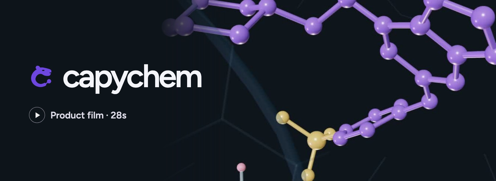

[](https://github.com/user-attachments/assets/f34b5ee5-8c14-44f0-a989-409440781ff8)

# Molecular design in 3D

CapyChem is a local workspace for seeing how a small change to a molecule affects its fit inside a protein. Compare two candidates in the same pocket, inspect the atoms that come into contact, and export the exact 3D pose on screen.

**[Download the demo ZIP](https://github.com/ogngnaoh/capychem/blob/6d482de562679923daea41d151d2dbded3a22041/assets/demo/capychem-studio-demo.zip?raw=1)** · [Run a live experiment](#run-a-live-experiment)

<details>
<summary>Play the 28-second film here</summary>

https://github.com/user-attachments/assets/f34b5ee5-8c14-44f0-a989-409440781ff8

</details>

## Try the recorded workspace

The demo includes 11 experiments and three studies. You need Python 3 and a browser with WebGL. Once downloaded, it runs offline.

1. [Download the demo ZIP (13 MB)](https://github.com/ogngnaoh/capychem/blob/6d482de562679923daea41d151d2dbded3a22041/assets/demo/capychem-studio-demo.zip?raw=1) and extract it.
2. Open a terminal in the folder containing `serve.py` and run `python3 serve.py`.
3. [Open the CDK2 experiment](http://127.0.0.1:5182/experiments/58c63b90-086a-4cb6-adee-e09657734574?mode=demo). Select **NU6094**, then **NU6102**. Drag to rotate the pocket. Select **ASP86** to see which atoms the added group reaches.

**Does the contact show up again?** In the [three-run study](http://127.0.0.1:5182/studies/a73fc517-6425-490a-a921-9ea3e7c0686d?mode=demo), each run uses a different sampling seed. Compare the selected poses:

| Molecule | Runs that reached Asp86 |
| --- | ---: |
| NU6094 · parent | 0 of 3 |
| NU6102 · sulfonamide | 3 of 3 |
| Carboxamide variant | 2 of 3 |

Open the carboxamide run that missed. **Download selected pose** saves the coordinates behind that result. These counts describe calculated contacts in a fixed protein structure. Measuring binding strength requires experimental data.

<details>
<summary>Run the recorded workspace from source</summary>

From the repository root, with Node.js 22 and pnpm 11.5.0:

```sh
pnpm install --frozen-lockfile
pnpm studio
```

Open [Studio in recorded mode](http://127.0.0.1:5181/?mode=demo). To build the portable ZIP, run `python3 scripts/package_demo.py`.

</details>

## Run a live experiment

The supplied-molecule workflow runs on CPU without API keys. Automatic setup has been validated on Apple silicon macOS with **uv**, **Node.js 22**, **pnpm 11.5.0**, and **PostgreSQL 16+**. From the repository root:

```sh
uv sync --frozen --python 3.12
pnpm install --frozen-lockfile
uv python install 3.11
.venv/bin/python scripts/setup_science.py --python "$(uv python find 3.11)"
.venv/bin/python scripts/dev.py
```

Open [Studio](http://127.0.0.1:5181), choose **New experiment → Evaluate candidates**, select **CDK2 · NU6094 para growth**, and paste these two molecules. Review the rules and launch the experiment.

```text
c1ccc(Nc2nc(OCC3CCCCC3)c3nc[nH]c3n2)cc1 NU6094
NS(=O)(=O)c1ccc(Nc2nc(OCC3CCCCC3)c3nc[nH]c3n2)cc1 NU6102
```

The API saves your inputs to PostgreSQL. A separate worker uses RDKit and Meeko to prepare the molecules, AutoDock Vina to calculate poses, PoseBusters to check their geometry, and ProLIF to identify contacts. You can close the tab and return to the saved result. Coordinates and other experiment files live in `.local/artifacts/`.

- **Generate variants** by adding `--with-generator` to the science setup command before starting the launcher. This installs CPU PyTorch and the pinned LibInvent checkpoint (about 90 MB). LibInvent proposes side groups. The worker then evaluates them in the pocket.
- **Use an existing PostgreSQL database** by passing `--database-url` to `scripts/dev.py`. The default launcher keeps its own cluster under `.local/postgres/`.
- **Supply your own Vina executable** with `scripts/setup_science.py --vina-binary /path/to/vina` on platforms without the automatic installer. Use version 1.2.7. The full live workflow above was verified on Apple silicon.

## Development and license

The Studio is in [apps/studio](apps/studio), the API in [apps/api](apps/api), and the experiment engine in [packages/core](packages/core/capychem/experiments). The original PMO benchmark app still runs separately via `make setup` and `make dev`. [Development and testing conventions](AGENTS.md)

CapyChem is [MIT licensed](LICENSE). Bundled software, fonts and scientific inputs retain their own terms. [Studio notices](apps/studio/public/THIRD_PARTY_NOTICES.txt) · [Scientific sources and licenses](data/reference/cdk2/THIRD_PARTY_NOTICES.txt)
