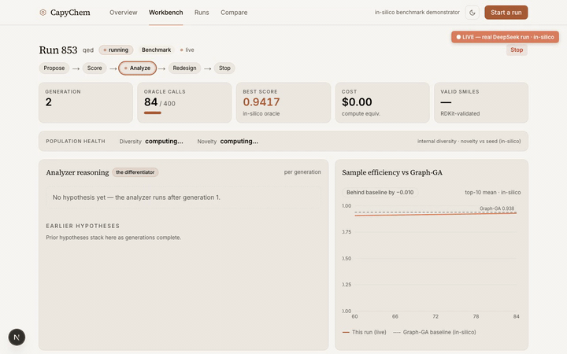
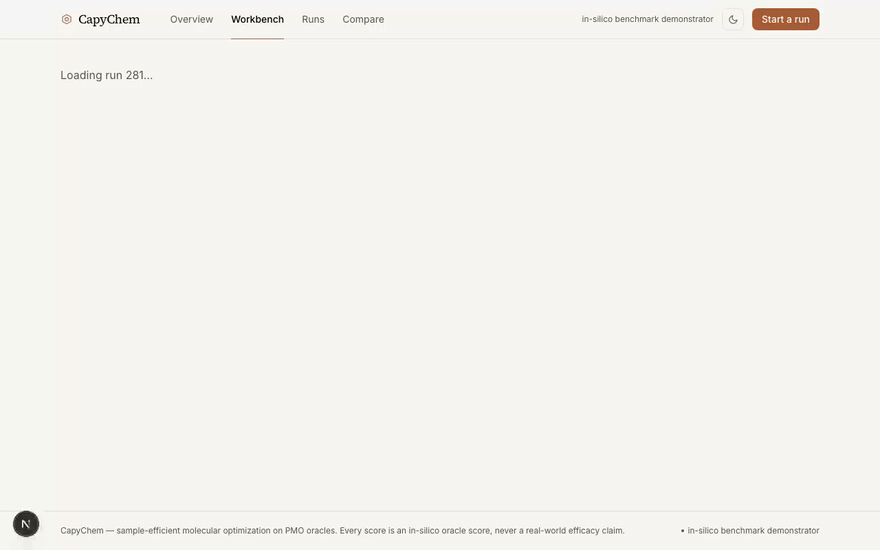
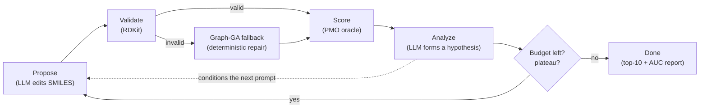
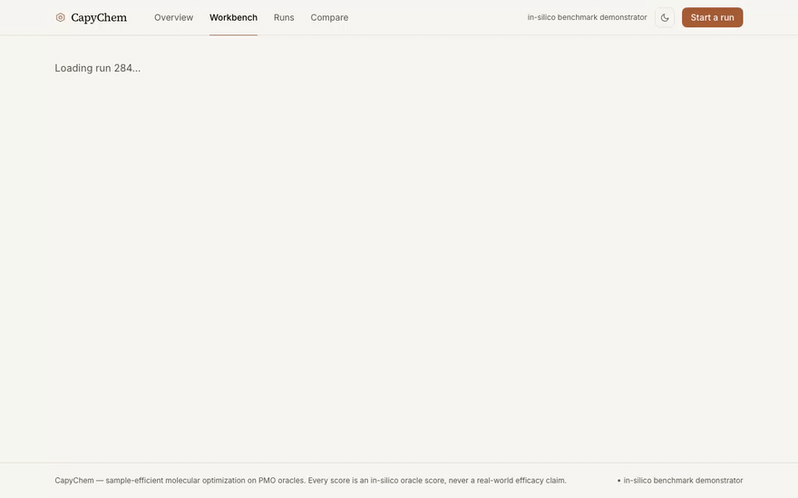
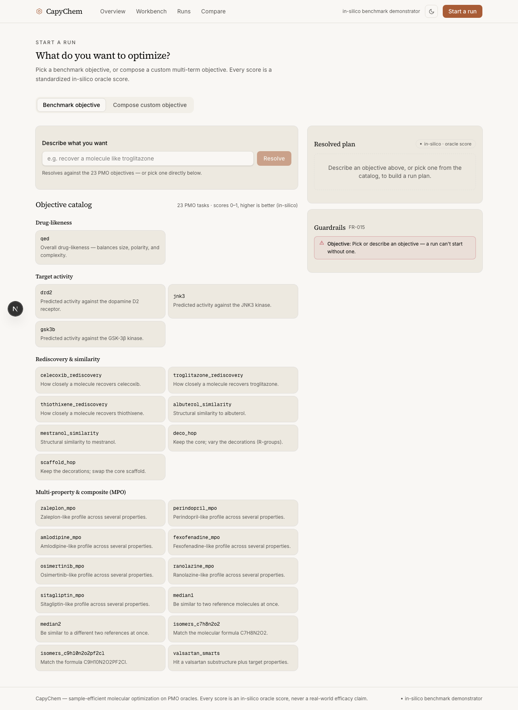
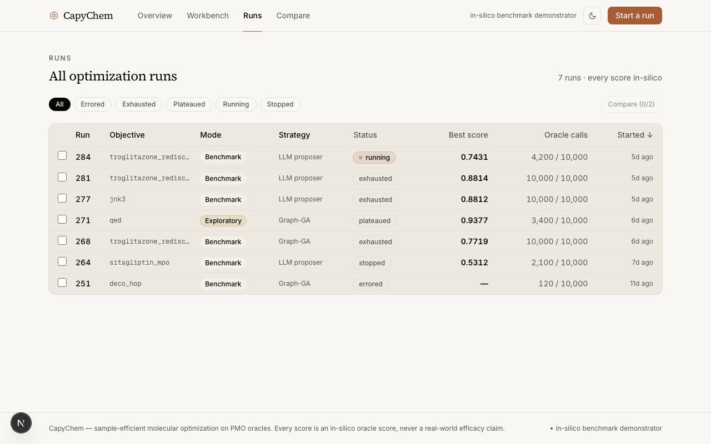
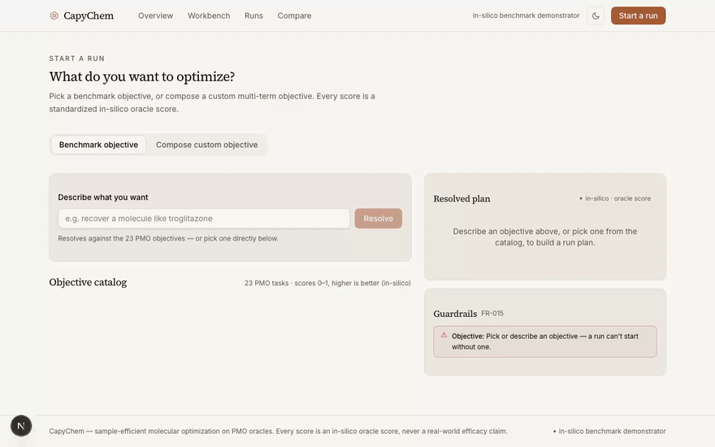
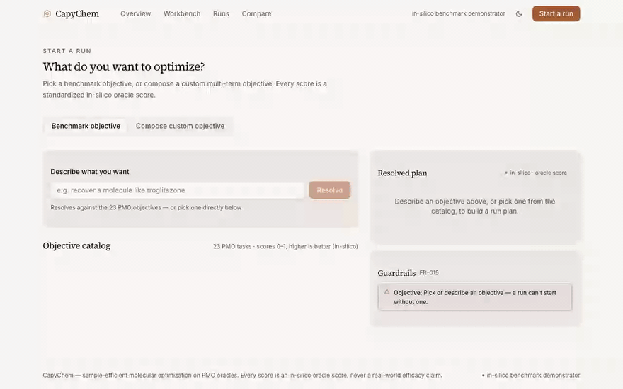
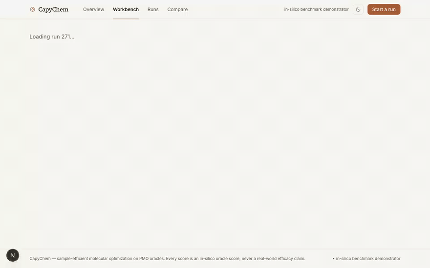
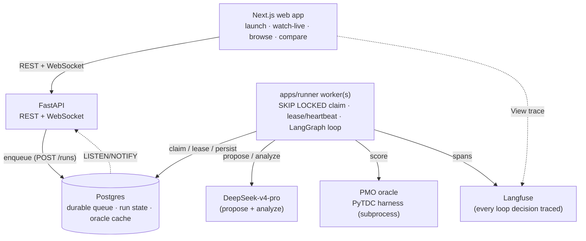

# CapyChem

[](https://github.com/ogngnaoh/capychem/actions/workflows/ci.yml)

**A durable, Postgres-backed job-processing engine for sample-efficient optimization — demonstrated on
molecular optimization.**

**In one breath:** you hand the system an expensive-to-call scoring function (here: a chemistry
benchmark scoring how "good" a candidate molecule is) and a hard budget on how many times you're allowed
to call it. It runs many rounds of *propose → score → learn → propose again*, spending that budget as
wisely as it can. Chemistry is just the workload here — the engineering that matters is how reliably and
cheaply the system schedules, executes, caches, and recovers that expensive work.

### Backend engineering, up front

- **Producer → durable queue → worker pool.** `POST /runs` only enqueues a row; a separate worker
  process (one or several) claims it with `SELECT … FOR UPDATE SKIP LOCKED` and drives it to completion.
  Postgres *is* the queue — no Redis, no broker, no Celery, no k8s.
- **Lease, heartbeat, reclaim.** Each claimed run holds a time-boxed lease the worker renews on a
  heartbeat; if a worker crashes, the lease expires and any live worker reclaims and resumes the run from
  its last persisted generation. A `UNIQUE(run_id, index)` constraint plus owner-fenced writes close the
  double-execution gap a merely-*stalled* ("zombie") worker could otherwise reopen.
- **Cross-process live events.** Postgres `LISTEN/NOTIFY` fans generation/analyzer/completion events out
  to every API process's WebSocket clients, so live updates keep working even when a *different* process
  is driving the run.
- **A persistent, cross-run oracle-score cache.** RDKit-canonicalized, oracle-version-scoped; a hit costs
  $0 of real compute and, in exploratory mode, doesn't spend the run's oracle-call budget.
- **Backpressure + idempotency.** Bounded per-worker concurrency, keyset-paginated `GET /runs`, and a
  TOCTOU-safe `Idempotency-Key` on `POST /runs`.
- **Durable resume.** A crash, an oracle-worker outage, or hitting the cost cap all replay cleanly from
  persisted state to the same terminal result — no lost work.
- **A hard subprocess isolation boundary.** The legacy scoring stack (pinned PyTDC/RDKit) runs in its own
  environment, reached only through a typed subprocess + JSON contract — never imported.
- **A real CI gate.** Ruff + mypy (strict) + the full pytest suite (Postgres- and harness-backed) run on
  every push.

The full run lifecycle, the queue/lease/fencing protocol, the cache design, and the hard problems (plus
two honestly-documented known limitations) solved along the way are in
[`docs/architecture.md`](docs/architecture.md).

---

The single workload this backend demonstrates on, end to end, is a closed-loop molecular optimization
agent: a language model proposes candidate molecules, each is scored by a benchmark oracle, and — the
part most systems skip — the model then *reasons over what just worked* and conditions its next round of
proposals on that hypothesis. The goal is not the best molecule per hour of compute; it's the **best
molecule per oracle call**.

> **In-silico only.** Every score in this project is a standardized in-silico benchmark-oracle score. CapyChem
> optimizes those scores and reports them as such. It makes **no claim of real-world drug-discovery efficacy**,
> and it is strictly upstream of any patient, wet-lab, or clinical use.

<p align="center">
  
</p>

*A ~13-second tour (in-silico benchmark scores throughout): resolve a benchmark objective → the analyzer
writes a hypothesis each generation and the score climbs live, still tracking the Graph-GA baseline mid-run →
the finished run beats the strong Graph-GA control head-to-head. Focused clips of each capability are under
their sections below. For the trace-level view of one run, see the [Langfuse walkthrough](docs/langfuse-walkthrough.md).*

<p align="center">
  
</p>

*A finished run: the top-10 mean score climbs with each batch of oracle calls, the best molecules are listed
with their scores, and every generation records the hypothesis the agent used to steer the next one.*

> **Proof it runs live.** The tour above is a *deterministic* capture — reproducible and honest by construction.
> Below is an **unedited real run**: DeepSeek proposing and analyzing live, the compute cost ticking up, and real
> 2D structures + the score-vs-Graph-GA-baseline curve streaming in over a WebSocket (still honestly behind the
> baseline mid-run). All in-silico.

<p align="center">
  
</p>

---

## What it is (no chemistry required)

You give CapyChem an **objective** (a scoring function — e.g. "how drug-like is this molecule?") and a
**budget** (how many times you're allowed to call that scoring function). Calling the oracle is the expensive,
rationed resource, so the whole game is spending those calls wisely.

Each generation, the agent:

1. **Proposes** a batch of candidate molecules (as text strings — SMILES) by asking an LLM to edit the current
   best ones.
2. **Validates** every candidate with a chemistry toolkit (RDKit); anything malformed is repaired by a
   deterministic fallback so a bad LLM batch never wastes the budget or stalls the loop.
3. **Scores** the valid candidates against the benchmark oracle.
4. **Analyzes** the results — the LLM looks at what scored well vs. poorly and writes a short hypothesis
   (*"focus: introduce a hydrogen-bond donor; avoid: halogen substituents"*).
5. **Redesigns**: the next generation's prompt is conditioned on that hypothesis. Repeat until the budget is
   spent or the score plateaus.

The **analyze step (4) is the differentiator.** The reference architecture this project reimplements
(MOLLEO) uses an LLM only as a mutation operator — it has *no* analyze step. Adding a closed analysis loop is
what makes CapyChem an *agent that reasons about its own progress* rather than a fancy random-mutation engine.

## Results — the benchmark (G1)

CapyChem was measured on **PMO** (Practical Molecular Optimization), the standard 23-task benchmark the field
uses to compare sample-efficient optimizers. The metric is **AUC of the top-10 mean score vs. oracle calls**
under a **10,000-oracle-call budget** — it rewards getting good *early*, not just eventually. The baseline is
**vanilla Graph-GA**, a strong classical genetic algorithm (not a trivial one).

**CapyChem beats or matches Graph-GA on all 21 comparable PMO tasks · decisive on 9 · 2 of 23 excluded for cause (defective oracles, not losses) · bar >=6/23.**

> **Caveats, in one place.**
> - **Comparable set is 21 of 23.** `sitagliptin_mpo` and `valsartan_smarts` are excluded for cause, not
>   counted as losses: the former's oracle emits scores outside `[0, 1]` (incomparable by the metric); the
>   latter's Graph-GA control scores **0.757** where the published PMO value is **0.000** — the pinned legacy
>   oracle isn't faithfully reproducing that task here. Both were caught by a baseline-reproduction check and
>   excluded, not silently kept.
> - **Single seed per task**, not an averaged multi-seed study.
> - Of the 21 comparable tasks, **9 are decisive** (~0.1 AUC or more); **4 are within single-seed noise**
>   (< 0.03 AUC) and reported as ties, not wins: `qed` (+0.005), `deco_hop` (+0.009), `zaleplon_mpo` (+0.018),
>   `drd2` (+0.024).
> - **No SOTA claim.** State-of-the-art on PMO is a non-LLM method (Genetic GFN). The value here is the
>   closed analysis loop, flexibility, and explainability under a hard oracle budget — not topping a
>   leaderboard.

| | |
|---|---|
| Comparable PMO tasks (of 23) | **21** |
| Decisive wins (~0.1 AUC or more) | **9** |
| Excluded for cause (oracle defects) | 2 of 23 |
| Benchmark goal (bar) | ≥ 6 of 23 → **met** |
| Full-sweep compute cost | **$18.94** (10k calls × ~21 tasks, under the $20 cap) |

<details>
<summary>▶ Watch: a finished LLM+analyzer run beats a vanilla Graph-GA run head-to-head (GIF)</summary>
<p align="center">
  
</p>
</details>

Decisive wins included `troglitazone` (+0.563), `mestranol` (+0.397), and `celecoxib` (+0.344). The full
per-task verdict — every AUC, the baseline-reproduction gap, and the exclusion rationale — is committed at
[`docs/04-compare-and-polish/g1-full23-10k-seed42.json`](docs/04-compare-and-polish/g1-full23-10k-seed42.json).

## How the closed loop works



The dashed arrow is the loop that MOLLEO lacks: the analyzer's hypothesis flows forward into the next
proposal prompt. Below, the analyzer's actual per-generation reasoning from a real run — legible without any
chemistry background:

<p align="center">
  
</p>

And the same loop in motion — the model wakes on a cold start, the analyzer writes a hypothesis each
generation, and the top-10 mean score climbs while still honestly tracking (behind) the Graph-GA baseline
mid-run:

<details>
<summary>▶ Watch: the loop live — cold start, per-generation hypotheses, climbing score (GIF)</summary>
<p align="center">
  
</p>
</details>

Every one of these steps is traced. From any run you can click **View trace** to open the full decision tree
in Langfuse — see the [trace walkthrough](docs/langfuse-walkthrough.md) for a step-by-step read of one run.

## The operator surface

A single Next.js web app covers the four operator flows end to end, talking to the FastAPI backend over REST
and a live WebSocket. (The UI adopts a warm, claude.ai-leaning design system.)

| Launch a run | Browse all runs |
|---|---|
|  |  |

**Compare two runs** overlays their score curves and puts their molecules and hypotheses side by side. Here an
LLM+analyzer run (coral) is compared against a vanilla Graph-GA run (blue) on the same task — note the
Graph-GA side reads *"No analyzer hypotheses (Graph-GA run)"*, which is exactly the capability gap CapyChem
closes:

<p align="center">
  
</p>

### Launch & resolve

Pick a benchmark objective from the catalog, or describe one in plain language — and when nothing in the
23-task benchmark matches, the launcher **refuses and says why** rather than guessing (that refusal is a
feature, not a failure):

<details>
<summary>▶ Watch: resolving a benchmark objective, and a refused plain-language mismatch (GIF)</summary>
<p align="center">
  
</p>
</details>

### Make it your own

Compose a custom multi-term objective (flagged **exploratory**, walled off from the benchmark claim) or bring
your own seed molecules — RDKit validates every SMILES server-side before the run starts:

<details>
<summary>▶ Watch: composing a custom objective and pasting your own seed molecules (GIF)</summary>
<p align="center">
  
</p>
</details>

### Quality & lineage export

Every candidate carries a quality/trust read-out (Lipinski, Veber, PAINS, Brenk), and the full lineage exports
to CSV/SDF:

<details>
<summary>▶ Watch: per-candidate quality read-out and one-click lineage export (GIF)</summary>
<p align="center">
  
</p>
</details>

## Architecture



`POST /runs` only enqueues a row — the request handler never drives a loop itself. A separate `apps/runner`
worker process (or the API's own inline dev/test worker) claims and drives it; the API process serving a
WebSocket client may not be the one driving the run at all, which is exactly what Postgres `LISTEN/NOTIFY`
is for. Full protocol + design rationale: [`docs/architecture.md`](docs/architecture.md). A few decisions
worth calling out here:

- **The oracle bridge is a hard isolation boundary.** The PMO benchmark pins a legacy stack (PyTDC 0.3.6,
  Python 3.10). That lives in a separate `harness/` environment; modern code never imports it — it shells out
  via a typed JSON subprocess. This keeps the reproducible-benchmark contract intact without dragging old
  dependencies into the app.
- **The queue and the cache are both just Postgres.** No Redis, no broker, no Celery, no k8s: a durable
  `SELECT ... FOR UPDATE SKIP LOCKED` queue with lease/heartbeat/reclaim (plus structural fencing against a
  stalled-then-revived worker) and a persistent, RDKit-canonicalized, oracle-version-scoped oracle-score
  cache — exploratory-mode-only, so the benchmark/eval path stays byte-identical. A cache hit is $0 and
  uncounted against the run's oracle budget.
- **Observability is the source of truth.** Every LangGraph node (`propose`, `validate`, `score`, `analyze`,
  `fallback`, `stop_check`) emits a Langfuse span nested under a per-run trace, so "what did the agent decide,
  and why?" is auditable step by step.

## Quickstart

Prerequisites: Python 3.12 + [`uv`](https://docs.astral.sh/uv/), Node 22 + `pnpm` 11.5.0, Docker. The harness's
Python 3.10 (PyTDC 0.3.6) is fetched automatically by `uv` — you don't install it.

```bash
git clone <repo> && cd CapyChem
make setup     # deps (modern + harness) · .env.local · local Postgres
make dev       # API on :8000 + web on :3000
```

`make setup` is the whole cold start. The explicit steps it runs, if you'd rather do them by hand:

```bash
# 1. Install deps
uv sync                       # modern Python (core + api)
uv sync --project harness     # isolated legacy harness env (PyTDC 0.3.6, Python 3.10 — uv auto-fetches it)
pnpm install                  # web

# 2. Local infra — Postgres (required); Langfuse (optional, tracing only)
docker compose -f infra/compose.yml up -d
docker compose -f infra/langfuse-compose.yml up -d   # optional — the app runs fully without it

# 2b. Schema — migrations run automatically on API startup, so this is redundant if you
#     start the API; run it only to prepare the schema first (e.g. for the DB-backed tests).
uv run alembic upgrade head

# 3. Run the stack
uv run uvicorn capychem.api.main:app --reload        # API  → :8000
pnpm --filter web dev                                 # web  → :3000

# 4. Or run the benchmark from the CLI (needs no database)
uv run capychem-eval --task=qed --budget=10000 --seed=42     # one PMO task
```

Copy `.env.example` → `.env.local` and adjust (`make setup` does this for you). By default the proposer runs a
deterministic network-free stub; set `CAPYCHEM_PROPOSER_BACKEND=direct` + `DEEPSEEK_API_KEY` to use the real
DeepSeek model. There is **no auth or hosting** — this is a single-user tool you fork and run locally.

> Running the test suite? `uv run pytest` ("Test all") is green on a bare clone — the `apps/api` integration
> tests **skip** (not error) when Postgres or the harness venv isn't reachable, and run + pass once both are
> present. For the full dev loop, the CI checks, and the project invariants, see
> [`CONTRIBUTING.md`](CONTRIBUTING.md).

## Repository map

| Path | What's there |
|---|---|
| `apps/web/` | Next.js operator UI (launch / watch-live / browse / compare) |
| `apps/api/` | FastAPI REST + WebSocket; enqueues runs and hosts the durable-queue event bus |
| `apps/runner/` | Standalone out-of-process worker: claims durable-queue rows and drives the LangGraph loop |
| `packages/core/` | `capychem` core: the loop, proposer, analyzer, fallback, oracle adapter, cache, eval harness |
| `harness/` | Isolated legacy PMO/PyTDC env (never imported — subprocess bridge only) |
| `apps/worker/` | Modal app (LLM endpoint + oracle worker pool) |
| `docs/` | Milestones, per-slice design docs, [`architecture.md`](docs/architecture.md), and the [trace walkthrough](docs/langfuse-walkthrough.md) |

## What this project is (and isn't)

CapyChem is a portfolio-scale engineering build: an autonomous agent loop, a rigorous benchmark harness with
committed baselines, a full-stack operator surface, and end-to-end observability. It reimplements a published
reference architecture (MOLLEO) and adds a closed analysis loop on top. It is **not** a novel ML-architecture
contribution, a chemistry-expertise product, or a claim about real-world molecules — see the in-silico note at
the top.
