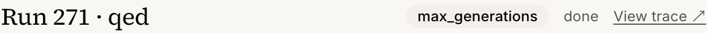
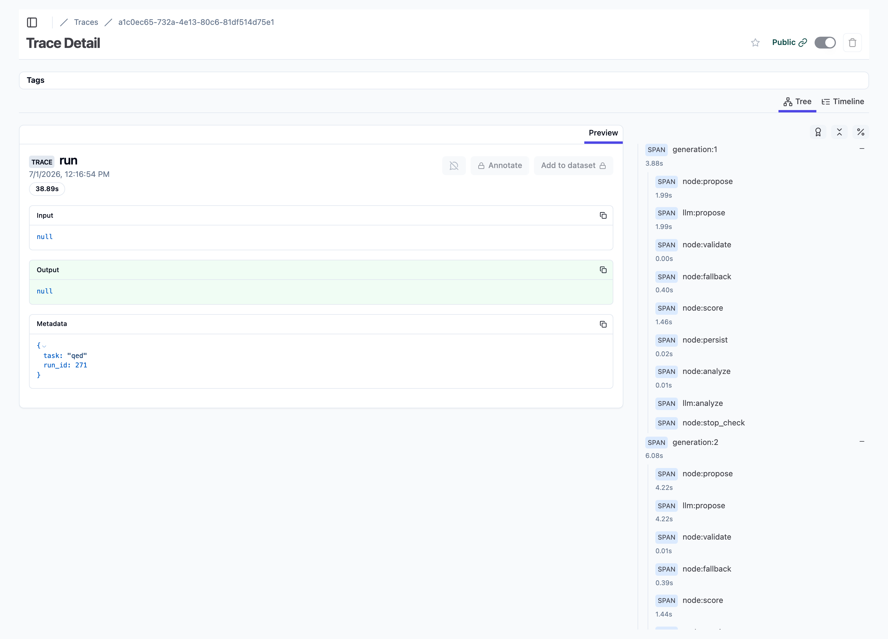
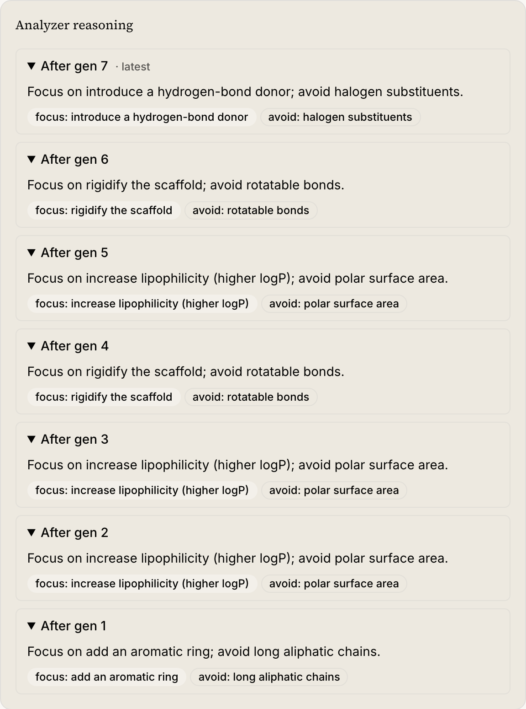

# Trace walkthrough: watching the closed loop think

This walks through **one real CapyChem run, end to end, as a trace** — no chemistry background needed. The
point is to show what "the agent reasons about its own progress" actually means, step by step, in a form you
can audit.

Every loop decision CapyChem makes is recorded as a **span** in [Langfuse](https://langfuse.com) (a
self-hosted observability tool). A span is just a timed, named record of one thing the system did, with its
inputs and outputs. Spans nest, so a whole run reads as a tree. From any run in the app you click **View
trace** to open it:

<p align="center">
  
</p>

The run below is **run 271**, task `qed` (a "how drug-like is this molecule?" score, 0–1). It ran **8
generations** and spent **80 oracle calls**, finishing at a best score of **0.9455** for **$0.0149**.

## 1. The trace tree — the whole run at a glance

<p align="center">
  
</p>

The top-level `run` trace holds one `generation:N` span per generation, and each generation holds the
node-by-node spans of one loop turn. The structure looks like this:

```
run  (task=qed, run_id=271, 38.9s)
├── generation:0        ← seed population — no LLM, no analysis yet
│   ├── node:propose        (seed the starting molecules)
│   ├── node:validate       (RDKit checks every SMILES)
│   ├── node:fallback
│   ├── node:score          (oracle scores the batch)
│   ├── node:persist        (write candidates + scores to Postgres)
│   └── node:stop_check     (budget / plateau?)
├── generation:1
│   ├── node:propose
│   │   └── llm:propose      ← the LLM edits the current best molecules
│   ├── node:validate
│   ├── node:fallback        ← repairs any invalid LLM output
│   ├── node:score
│   ├── node:persist
│   ├── node:analyze
│   │   └── llm:analyze      ← THE DIFFERENTIATOR: forms a hypothesis
│   └── node:stop_check
├── generation:2 … 7        (same shape)
```

Two things to notice immediately:

- **`generation:0` has no `llm:propose` and no `llm:analyze`.** Generation 0 is just the seed population being
  scored — there's nothing to learn from yet. The LLM proposal and the analysis only appear from generation 1
  onward. This matches the design: *analyze after every generation ≥ 1.*
- **Every generation carries a `node:analyze` → `llm:analyze` pair.** That is the loop MOLLEO doesn't have,
  right there in the trace.

## 2. Reading one generation, span by span

Here is generation 1 with its real span durations (from this exact trace):

| Span | Time | What happened |
|---|---:|---|
| `node:propose` → `llm:propose` | 1986 ms | The LLM was asked to edit the current best molecules and returned a batch of new SMILES. |
| `node:validate` | 4 ms | RDKit parsed each candidate. |
| **`node:fallback`** | **395 ms** | **Some LLM candidates were invalid — so the deterministic Graph-GA operator repaired the batch.** The budget wasn't wasted; the loop stayed at full throughput. |
| `node:score` | 1456 ms | The valid batch was scored by the PMO oracle (the expensive step). |
| `node:persist` | 17 ms | Candidates, scores, and provenance written to Postgres. |
| `node:analyze` → `llm:analyze` | — | The LLM read the generation's results and wrote a hypothesis (next section). |
| `node:stop_check` | — | Budget not exhausted, no plateau → continue. |

That 395 ms `node:fallback` is worth pausing on: it's the reliability guarantee in action. When the LLM emits
a malformed molecule, the loop doesn't stall or burn an oracle call on garbage — a classical graph-edit
mutation fills the slot. A degraded LLM can't collapse the run.

## 3. The differentiator: analyze → hypothesis → redesign

Open an `llm:analyze` span and you see the agent's reasoning turned into a compact, structured hypothesis. The
next generation's proposal prompt is templated with it. Here is how the hypothesis actually evolved across
run 271's generations:

| After generation | Hypothesis (focus / avoid) |
|---:|---|
| 1 | focus: **add an aromatic ring** · avoid: long aliphatic chains |
| 2 | focus: **increase lipophilicity (higher logP)** · avoid: polar surface area |
| 3 | focus: increase lipophilicity (higher logP) · avoid: polar surface area |
| 4 | focus: **rigidify the scaffold** · avoid: rotatable bonds |
| 5 | focus: increase lipophilicity (higher logP) · avoid: polar surface area |
| 6 | focus: rigidify the scaffold · avoid: rotatable bonds |
| 7 | focus: **introduce a hydrogen-bond donor** · avoid: halogen substituents |

The same sequence, rendered in the app's run-detail view:

<p align="center">
  
</p>

You don't need to know any chemistry to read the *behavior*: the agent isn't mutating at random. Each round it
commits to a direction, and if a direction stops paying off it changes tack (note it revisits "lipophilicity"
while things improve, then pivots to "rigidify the scaffold" and later "hydrogen-bond donor"). This is the
closed analysis loop — a hypothesis, applied, then revised in light of new scores.

## 4. The payoff — score per oracle call

Because the analyzer keeps steering toward what works, the top-10 mean score climbs steadily as the (rationed)
oracle calls are spent:

```
oracle calls:  20     30     40     48     56     63     72     80
top-10 mean:  0.822  0.871  0.913  0.933  0.935  0.941  0.942  0.943
```

That curve — score rising as a function of *oracle calls*, not wall-clock — is exactly what the PMO benchmark
rewards, and it's the whole thesis of the project: **spend the expensive budget wisely.**

## 5. See it yourself

1. Start the stack (`README` → Quickstart) and open a completed run in the app.
2. Click **View trace** in the run-detail header.
3. In Langfuse, expand the `generation:N` spans and open any `node:analyze` → `llm:analyze` to read the
   hypothesis that steered the next generation.

The trace shown here is `run` id `a1c0ec65-732a-4e13-80c6-81df514d75e1` (run 271). Every number in this
walkthrough — the durations, the hypotheses, the score curve — is read directly from that run's persisted
trace and database records. As with every score in this project, it is an **in-silico oracle score**, not a
claim about real molecules.
