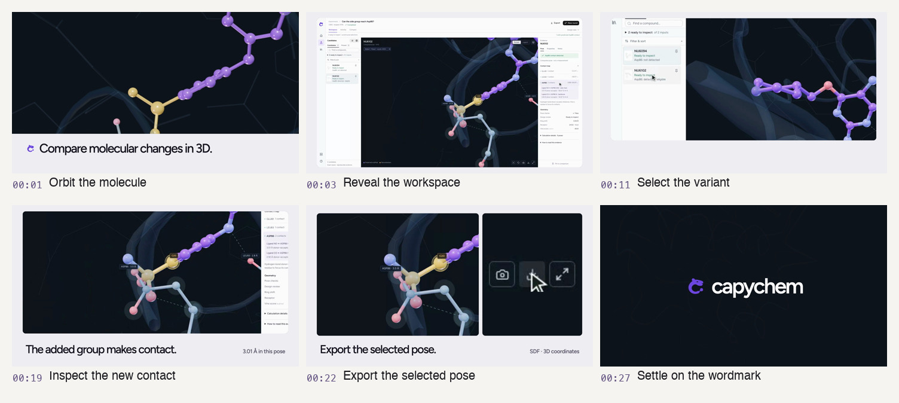

# CapyChem launch film

[Watch the 28-second cut](../../assets/demo/v10/capychem-studio-launch.mp4?raw=1) · [Edit the Remotion composition](../../apps/launch/src/product/SpatialLaunch.tsx) · [Export verification](../../assets/demo/v10/verification.json)

## What to watch for on X

| Clip | What you can see | Why it works here |
| --- | --- | --- |
| [Jitter · Infinite Canvas](https://x.com/jittervideo/status/1886737877268066813) | The seven-second clip shows nine artboards, then a tighter view of one row. The same blue “dimension” tile is recognizable in both views. | The tile gives the eye somewhere to land after the change of scale. In CapyChem the gold group is that landmark as the molecule resolves into the live viewport. |
| [Screen Studio · Masks](https://x.com/screenstudio/status/1900123555871772737) | A masked field in an activation dialog, the editor timeline and mask controls, and the same dialog with the result are all visible in the clip. | Seeing the original field again explains what the tool changed. CapyChem keeps the same pocket in view while the user switches variants, then gives the new contact a short hold. |
| [Motionstash Studio · B2B launch film](https://x.com/motionstashco/status/2120983506230681641) | In one shot a recorded interview occupies most of the frame. Later a feedback dialog and oversized pointer sit in the middle of a much denser interface. A short line of type gets a shot of its own. | Each shot has one thing to read. CapyChem gives the export button its own magnified piece of the recording beside the pose. The surrounding product stays visible. |
| [AB Works · Hatch snippets](https://x.com/ab_workss/status/2122370588350042588) | The four-panel montage brings together a lime object, oversized type, simple icons and a brand mark. A shared black, white and lime palette ties the panels together. | Changing subject and scale supplies rhythm. CapyChem carries violet and gold from the model into the workspace, then leaves only the violet mark and wordmark at the finish. |

These observations come from sampled playback on X. The shot timing below belongs to CapyChem. For a static composition reference, Spline puts its 3D objects in framed examples with their descriptions underneath. The product gets its own uninterrupted area. [Spline on Mobbin](https://mobbin.com/sites/sections/ce2fd149-68e2-4e2c-9cec-23b88383db95)

## The cut

The opening uses an **orbit** around the group, then a **matched transition** into the live recording. Keeping the atoms at the same angle and screen position lets the application frame appear around them. The ending uses a **dolly out** through the 3D scene. Near atoms travel across the frame faster than distant parts of the protein. That difference, called **parallax**, makes the pullback feel spatial.

| Time | Picture | What the viewer can follow |
| --- | --- | --- |
| 0–4 s | An orbit around the added group resolves into the Studio viewport. The product line sits on a solid strip outside the picture. | The object in the opening is the one the user can inspect. |
| 4–10 s | The camera moves across the supplied molecules and the recorded Run click. The result follows an explicitly shortened compute wait. | The user submitted a pair. The 23-second CPU time belongs to that run. |
| 10–18 s | The pointer switches candidates. The camera widens to show the selection and molecule together, then follows the inspection into the pocket. | The change in the model follows an action in the app. |
| 18–24 s | The camera holds on the added group, the measured distance appears beside the image, and a synchronized detail shows the coordinate download. | The contact and exported file belong to this selected pose. |
| 24–28 s | The camera pulls back through the protein structure. The centered purple mark and lowercase wordmark settle into place. | After the viewer has seen the product work, the last thing to remember is its name. |

The film is silent. All product footage and molecular coordinates come from the same verified local run. The edit shortens the wait between submission and results. During review at feed size, we enlarged the two important clicks and found a three-frame magenta calibration flash at the start of setup. The final export starts that shot later. A check of all 840 decoded frames at 320 pixels wide found zero saturated marker pixels. [Source take and selected pose](../../assets/demo/v8/verification.json)
