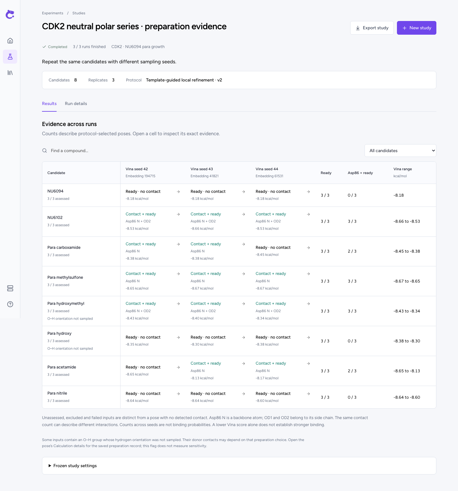

# Validation and scientific scope

An eight-molecule **neutral polar extension study** was declared before running three embedding/Vina seed pairs. All 24 candidate/run pairs produced review-ready poses. The first execution took about **three minutes sequentially** on the local CPU; this is an example runtime, not a deadline.

| Molecule | Runs with an eligible Asp86 contact | Contact detail |
|---|---|---|
| NU6094 parent control | 0 / 3 | No detected Asp86 hydrogen bond |
| NU6102 positive control | 3 / 3 | Backbone N and side-chain OD2 |
| Para carboxamide | 2 / 3 | Backbone N |
| Para methylsulfone | 3 / 3 | Backbone N |
| Para hydroxymethyl | 3 / 3 | Backbone N and OD2; O–H orientation caution |
| Para hydroxy | 0 / 3 | O–H orientation caution |
| Para acetamide | 2 / 3 | Backbone N |
| Para nitrile | 0 / 3 | No detected Asp86 hydrogen bond |

  

These counts describe the protocol-selected pose in each run, not experimental replicates or activity probabilities. Selection favors a review-ready Asp86-contact pose before comparing Vina scores; it need not choose the lowest-score pose overall. Contact atom names distinguish chemically different interactions that would otherwise share the same count.

A diagnostic with fixed heavy atoms showed that changing an O–H hydrogen's orientation can change whether a donor contact is detected. It did not establish which orientation the protein favors. The production engine now saves its fixed-hydrogen preparation policy and graph-derived O–H warnings. Original results remain intact. A fresh three-seed study reproduced all 62 saved pose geometries, scores, and contact records, with contact ordering treated as immaterial. All **385 artifacts** were checked, and **214 contacts** independently reconstructed. See [`neutral-polar-study-validation.json`](neutral-polar-study-validation.json) for the frozen input, comparison, audits, diagnostic, and exact limits.

The existing known, mixed-input, strict-property, and generated-input baselines were also replayed. Their contract and artifact checks passed; the implementation fingerprint change remains explicitly marked for review rather than automatically promoted as scientific improvement.

Two fresh **live API runs on an Apple M2 Pro with 16 GB memory** used the v2 protocol and 16 embedding attempts per candidate:

| Run | Result | Submission to completion |
|---|---|---|
| Known NU6094 / NU6102 comparison | Two review-ready candidates, six poses; selected NU6102 pose meets the Asp86 contact hypothesis | **20.68 s** |
| LibInvent exploration, seed 43 | 32 proposals → 17 unique → 12 within property limits; 12 review-ready candidates, 51 poses, five contact hypotheses; no pose or embedding errors | **145.14 s** |

These are measured local examples, including API queueing, scientific process startup, and artifact publication. Installation, downloads, and reference preparation are excluded. Shared machine load and candidate complexity affect runtime. All **351 artifacts** from these runs were downloaded through the API and checked against their SHA256 hashes, sizes, and ETags.

For the selected NU6102 pose, three independent embedding seeds recovered the crystal pose within **0.28–0.36 Å heavy-atom RMSD**, retaining the Asp86 contact under the same geometry and hinge criteria. The broader known-series controls and a separate generated batch were also audited; the latter’s 52 saved structures, 293 scientific artifact hashes, and 135 contacts matched their recorded evidence. See [`science-validation-v2.json`](science-validation-v2.json) for the experimental controls and precise scope, and [`backend-validation-v2.json`](backend-validation-v2.json) for the live API records.

**This is receptor-informed retrospective validation.** The receptor conformation was chosen from the known NU6102 complex. NU6102 coordinates were held out from candidate placement and used for the retrospective comparison, but choosing its receptor already supplies useful structural information. These results establish that the curated workflow can recover a known interaction and expose generated hypotheses. They do not establish prospective docking accuracy, synthesis feasibility, or improved affinity.

The original NU2058 / 1H1P protocol missed that interaction. Investigation found a severe clash between the known target placement and Lys89 in the original receptor; local refinement lost the desired contacts. Changing the receptor alone was insufficient. The new protocol makes the chemical question narrower and testable: grow from a later NU6094 intermediate in the prepared open receptor. Earlier runs and their limitations remain preserved under their original protocol identity.

Application checks include **79 passing backend and local-operability tests**, with persistence cases on real Postgres, covering concurrent submissions and claims, expiry during a lock wait, stale publication, worker death, hard timeout, cancellation, immutable pose evidence, review conflicts, pagination, and guarded migration of the legacy schema. The latest operability audit also started an empty database, applied migrations, verified API/worker readiness, and checked terminal-hangup cleanup. It registered existing scientific environments; it did not reinstall every dependency on a fresh machine. A separate earlier retained-core regression run passed **294 tests**. SQLite convenience checks are supplementary; production uses Postgres. Browser workflows and scientific dependencies have separate validation records under [validation records](.).

Current boundaries: one curated CDK2 growth series; fixed receptor; omitted waters; a fixed neutral 9H scaffold and explicit hydrogen placement without receptor-conditioned orientation optimization; no pH ensemble, exhaustive stereoisomer search, synthesis planning, or potency prediction. The translucent pocket envelope is a visual aid, not a molecular surface calculation or energy field. The original CDK2 protocol remains available for historical comparison, not as a second general-purpose target workflow.

